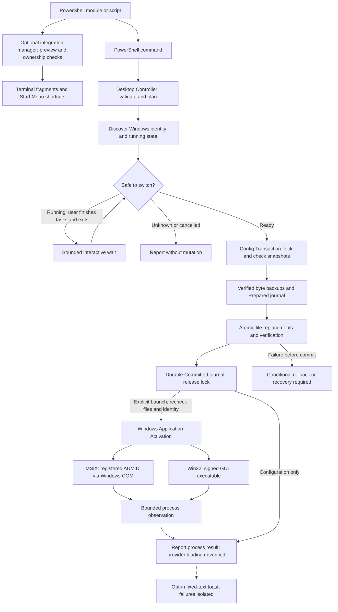

# Codex Mode Switcher

**A PowerShell controller for safely switching and starting Codex Desktop on Windows.**

**Version:** `0.2.1` · Windows native integration · Live Desktop provider E2E remains unverified

[Quick Start](#quick-start) · [Usage](#usage) · [Architecture](#architecture) · [中文说明](docs/README.zh-CN.md) · [Troubleshooting](docs/TROUBLESHOOTING.md)

[](https://github.com/styayur/codex-mode-switcher/actions/workflows/ci.yml)
[](https://github.com/styayur/codex-mode-switcher/releases/latest)
[](LICENSE)

Select ChatGPT OAuth or one saved custom API provider, such as DeepSeek, without
repeatedly editing `~/.codex/config.toml`. The controller backs up and verifies local
configuration, coordinates normal Desktop exit, and optionally starts the application
through Windows activation. It preserves native GPT model selection across switches.

This project is a **Desktop Controller**, not a CLI Profile Switcher. It provides no
model API gateway, GUI, background service or resident agent. It is an independent
community project, unaffiliated with OpenAI or DeepSeek.

## Quick Start

Use Windows and PowerShell **7.4+** as your normal user. No administrator access or Codex
CLI is required. Desktop must be installed for `-Launch`. Keep the **whole checkout**:
The module and entry scripts use `src/`; keep the complete distribution.

```powershell
git clone https://github.com/styayur/codex-mode-switcher.git
cd codex-mode-switcher
.\codex-mode.ps1 Diagnose -Json
```

Review downloaded files. If Windows attaches Mark of the Web (MOTW), remove it from the
reviewed PowerShell and C# source files with `Unblock-File`:

```powershell
Get-ChildItem . -Recurse -File -Include *.ps1,*.psm1,*.psd1,*.cs | Unblock-File
```

The tool never changes ExecutionPolicy. Organization policy and signing requirements
still apply.

Start with an **already working custom provider configuration**. Finish or stop relevant
Desktop tasks and exit the app normally. Then:

```powershell
.\codex-mode.ps1 Init
.\codex-mode.ps1 GPT -Launch
# After finishing tasks and exiting Desktop again:
.\codex-mode.ps1 DeepSeek -Launch
.\codex-mode.ps1 Status
```

Interactive launch asks you to confirm task safety. `-WaitForExit` allows a bounded wait
for normal exit. It never closes Desktop for you. Process absence alone does not prove
that tasks finished. Verify the selected provider/model in a **new Desktop task**.

`DeepSeek` is the legacy name for restoring whichever single custom provider you saved.
The tool does not create accounts, choose provider models or adapt API protocols.

## PowerShell module and Windows integration

Load from a checkout with `Import-Module .\CodexModeSwitcher.psd1`. For normal
`Import-Module CodexModeSwitcher` discovery, install the [release module archive](https://github.com/styayur/codex-mode-switcher/releases/tag/v0.2.1)
under your current-user PowerShell module directory; see [installation instructions](docs/WINDOWS-INTEGRATION.md).
Importing the module creates no files and launches no application.

```powershell
Import-Module CodexModeSwitcher
Get-CodexStatus
Test-CodexEnvironment
Start-CodexMode GPT -DryRun
Start-CodexMode GPT                 # Explicitly starts Desktop after safe switching
Start-CodexMode DeepSeek
# Same guards as the script; finish tasks and exit Desktop normally first.
```

`Start-CodexMode` launches by default; `-ConfigurationOnly` opts out. It also supports
`-WhatIf`, `-DryRun`, `-NonInteractive`, `-TasksStopped` and bounded wait options. Module
commands return structured results, including `State=Failed`; callers must inspect the
result. The script and cmd adapter additionally signal failure with a nonzero exit.

The exported `codex-mode` alias supports the original modes plus integration management:

```powershell
codex-mode install terminal          # Preview paths and commands; no writes
codex-mode install terminal -Apply   # Approve installation after reviewing the preview
codex-mode install startmenu -Apply  # Optional: Codex GPT / DeepSeek / Diagnose
codex-mode integration list
codex-mode uninstall terminal -Apply
codex-mode integration uninstall-all -Apply
```

Terminal integration adds three uniquely identified profiles through an owned JSON
fragment; it never rewrites user `settings.json`. Start Menu integration creates three
native shortcuts only in a dedicated current-user folder. Neither is installed by default.
There are no desktop shortcuts, context-menu entries or background services. Uninstall
only removes recorded files whose hashes still match; user edits and unowned files are
preserved. Uninstall previews are the default too; `-Apply` is explicit approval.

Notifications are separately optional:

```powershell
codex-mode install notifications     # Preview the notification identity shortcut
codex-mode install notifications -Apply
Start-CodexMode GPT -Notify
# The original script also accepts -Notify.
codex-mode uninstall notifications -Apply
```

This registers a native Start Menu identity shortcut, not a background notification
service. Notifications contain fixed status messages only. Windows can suppress them;
notification failure never changes the configuration result. No notification is requested
by module import, diagnostics, DryRun or a command without `-Notify`.

Outside PowerShell, `codex-mode.cmd` provides the same command routing when the checkout
is explicitly added to PATH; it does not change PATH itself. The legacy profile shortcuts
remain separately managed by `Install-DesktopShortcut.ps1`.

[Windows integration, ownership and recovery details](docs/WINDOWS-INTEGRATION.md).

## Authentication and billing

**ChatGPT OAuth is not an OpenAI API key.** ChatGPT subscription access and third-party
API billing are separate. Codex can retain its ChatGPT login while a custom provider is
selected. Configure your provider's appropriate environment-based credential separately;
never put API keys in this repository. This tool does not grant access or change quotas.

The controller does not read, copy, delete or rewrite `auth.json`, and does not invoke
`codex login`, doctor or other CLI commands. Sign in through Desktop when needed.
Credentials must be available to the launched application, which can differ from a shell's
environment for Windows-brokered MSIX activation. See OpenAI's
[Desktop provider configuration guidance](https://learn.chatgpt.com/docs/enterprise/connect-to-a-gateway).

## Usage

| Command | Behavior |
| --- | --- |
| `Status` / `Diagnose` | Read-only local selection, Desktop identity/state, backup and recovery diagnostics. |
| `Init` | Back up an existing config and save its active custom provider. Preserve saved state when on GPT. |
| `GPT` | Capture the active custom provider; select OpenAI/ChatGPT; retain or restore native model/reasoning selection. |
| `DeepSeek` | Restore the saved custom provider's selectors and tables, saving native GPT selection first. |
| `Toggle` | GPT/default → saved provider; custom provider → GPT. |
| `Recover -TransactionId <id>` | Restore an interrupted, uncommitted transaction when recorded hashes and backups still match. |

All mutations stop if Desktop is running or its identity/state is unknown. Without
`-Launch`, commands only change local configuration. Missing Desktop does not block
configuration-only use when discovery is reliable. MCP, sandbox, projects and unrelated
provider settings are preserved. Only one saved custom provider is managed.

```powershell
# Preview: no file creation, lock, prompt or activation
.\codex-mode.ps1 GPT -Launch -DryRun -Json

# Bounded interactive coordination after you finish/stop tasks
.\codex-mode.ps1 GPT -Launch -WaitForExit -ExitTimeoutSeconds 60

# Automation: attest task completion explicitly; running Desktop still blocks
.\codex-mode.ps1 GPT -Launch -NonInteractive -TasksStopped -LaunchTimeoutSeconds 30

# Explicit identity: registered MSIX AUMID or validated signed Win32 GUI executable
.\codex-mode.ps1 Diagnose -DesktopAppId '<registered-AUMID>' -Json
.\codex-mode.ps1 Diagnose -DesktopPath 'C:\Applications\Codex\Desktop.exe' -Json

# Configuration-only custom home (must be absolute)
$env:CODEX_HOME = Join-Path $HOME 'codex-alternate'
.\codex-mode.ps1 GPT -DryRun
```

The last path is illustrative, not an installation default. Automatic discovery uses
package/Start-menu metadata or Win32 uninstall registration. Explicit paths must identify
a signed OpenAI Codex GUI application; a CLI executable is rejected. Ambiguous results are
`Unknown`. The executable path, not its process name, establishes a running identity.

`-Json` prints a structured result; `-PassThru` returns a PowerShell object. Failures also
raise a sanitized terminating error for a nonzero script exit. `Committed`, `Rollback`,
`TransactionId` and `LaunchVerified` distinguish switching from startup. `LaunchVerified`
means an identity-matching process was observed; **ProviderLoaded remains NotVerified**.
`TaskActivity` remains `Unknown`. Diagnostics include local paths: redact them before sharing.

### Compatibility with v0.1.0

The five original commands and valid legacy provider state remain supported. `-NoLogin`
and `-SkipDoctor` are accepted compatibility flags with no effect: CLI login and diagnostics
are no longer implicit side effects. GPT now preserves known native model/reasoning fields
instead of always clearing the model. First switching from a custom provider without saved
GPT state still uses Codex/account defaults. Config-only commands now refuse a running or
unidentifiable Desktop. Repeated selections produce stable config; audit journals and
explicit Init backups may still accumulate.

### Optional PowerShell shortcuts

```powershell
.\scripts\Install-DesktopShortcut.ps1 -DryRun
.\scripts\Install-DesktopShortcut.ps1
# In a new PowerShell session:
cdx-gpt
cdx-deepseek -WaitForExit
# Remove only the unchanged, owned block:
.\scripts\Install-DesktopShortcut.ps1 -Action Uninstall
```

Installation is explicit, backed up and conflict-checked. Existing functions/aliases are
not overwritten. The default target is the current user's all-hosts PowerShell profile;
`-ProfilePath` can choose another. Startup only defines shortcuts; it runs no Codex checks.
Uninstall from the original checkout before moving it, then reinstall from the new location.

## Architecture

<!-- architecture:overview:start -->

<!-- architecture:overview:end -->

Read-only commands and DryRun stop before the transaction. The commit boundary is a
verified, durable `Committed` journal. Pre-commit failure attempts restoration only when
current bytes match recorded before/after hashes. Startup failure **never rolls back a
committed selection**. Newer external edits are preserved when detected.

```text
codex-mode.ps1             public entry
src/                      config, state, transaction, Desktop and diagnostics modules
scripts/                  explicit profile installer and development checks
tests/                    isolated Pester tests and synthetic application launchers
docs/                     Chinese guide, architecture, troubleshooting and validation
.github/workflows/        Windows checks and architecture rendering

$env:CODEX_HOME or $HOME/.codex/
  config.toml
  mode-switcher/
    deepseek-state.json   one saved custom provider
    gpt-state.json        native model/reasoning selection
    backups/              exact prior bytes of changed files
    transactions/         hashes, roles, status and backup references
    .lock                 serializes this tool's writers
```

See [architecture and source evidence](docs/architecture/README.md),
[audit and Windows capability evidence](docs/DESKTOP-VALIDATION.md), and
[recovery instructions](docs/TROUBLESHOOTING.md).

## Security

- Keep API keys in environment variables or a credential manager, outside the checkout.
- Credentials, session files and databases are never accessed by the controller.
- Config backups and provider fragments can contain secrets already embedded in your
  config. Keep them private; prefer environment-backed credentials before using this tool.
- No forced termination, process injection, undocumented Desktop API or task cancellation.
- No automatic deletion of backups. Ignore rules are safeguards, not a secret scanner.
- The lock coordinates this tool only. External applications can race the final filesystem
  check/write or activation; keep configuration editors closed during switching.

See [SECURITY.md](SECURITY.md) for the data boundary and private vulnerability reporting.

## Testing

```powershell
Install-Module Pester -RequiredVersion 5.7.1 -Scope CurrentUser -Force -SkipPublisherCheck
Install-Module PSScriptAnalyzer -RequiredVersion 1.25.0 -Scope CurrentUser -Force
pwsh -NoProfile -File .\scripts\Test-Project.ps1
```

Windows CI parses PowerShell, runs lint and executes isolated Pester tests. Tests use
synthetic homes, application identities and launchers. No real Desktop is started or
closed. Mocked test success, native discovery observations and full Desktop session
acceptance are reported separately in [the validation record](docs/DESKTOP-VALIDATION.md).

## Limitations

- No guarantee of hot reload or seamless continuation of old sessions across providers.
  Restart normally and verify in a new task. No CLI profiles or internal App Server control.
- Third-party API compatibility belongs to that service and your Codex version; a working
  protocol-compatible endpoint is required. Direct DeepSeek inference is not verified here.
- MSIX `-Launch` currently requires the default Codex home with no conflicting persistent
  `CODEX_HOME`. Brokered environment inheritance is unverified; custom homes are refused.
  Win32 launch explicitly passes `CODEX_HOME`, but its actual Desktop consumption needs E2E testing.
- Only user-level config is edited. An active root profile blocks launch; project, managed,
  environment and application overrides are not comprehensively inspected.
- Conservative TOML editing supports ordinary single-line assignments and bare managed
  keys/provider table names. Multiline values and quoted/array provider tables are refused.
  Unrelated TOML is preserved, not fully parsed; start from valid configuration.
- Each file replacement is atomic on supported filesystems. A multi-file transaction uses
  a recovery journal, not a filesystem-wide atomic commit. Linked/reparse paths are refused.
- The scripts are unsigned. Windows PowerShell 5.1 is used only as the inbox Appx discovery
  bridge; users run the controller with PowerShell 7.4+.

## Contributing

See [CONTRIBUTING.md](CONTRIBUTING.md). This release adds native integration; real Desktop
restart/provider acceptance remains a separate, explicitly unverified capability check.

## License

[MIT](LICENSE), following the Stya Yur Open Source Studio
[license policy](https://github.com/styayur/styayur/blob/main/LICENSE_POLICY.md) for small
scripts and automation. Product names belong to their respective owners.
