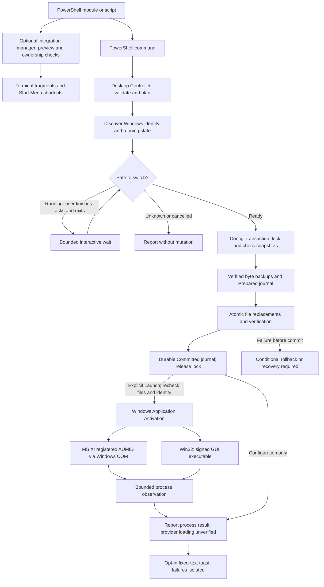

# Architecture and source evidence

The authoritative diagram is the marked Mermaid block below. [Back to README](../../README.md).
It separates **Desktop Controller**, **Config Transaction**, and **Windows Application Activation**.
This document describes the v0.2.1 implementation; it does not certify provider connectivity.

## Source map

| Component | Responsibility | Source |
| --- | --- | --- |
| Public entry | Parameters, human/JSON/object output, sanitized nonzero failures | [codex-mode.ps1](../../codex-mode.ps1) |
| Controller | Preflight, safe-exit coordination, transaction and opt-in launch | [Controller.ps1](../../src/Controller.ps1) |
| Config | Conservative, case-sensitive TOML fragment editing | [Config.ps1](../../src/Config.ps1) |
| State | Legacy custom state, native GPT selection, immutable switch plan | [State.ps1](../../src/State.ps1) |
| Transaction | Snapshot checks, exclusive lock, backups, atomic replacement, journal and recovery | [Transaction.ps1](../../src/Transaction.ps1) |
| Discovery | Registered MSIX/Win32 identity and exact-path process matching | [DesktopDiscovery.ps1](../../src/DesktopDiscovery.ps1), [Windows inventory](../../src/Get-WindowsInventory.ps1) |
| Lifecycle | Bounded normal-exit wait and process verification | [DesktopLifecycle.ps1](../../src/DesktopLifecycle.ps1) |
| Activation | Documented Windows COM AUMID activation | [WindowsActivation.cs](../../src/WindowsActivation.cs) |
| Diagnostics | Allowlisted selection metadata and safe error messages | [Diagnostics.ps1](../../src/Diagnostics.ps1) |
| Optional shortcuts | Explicit conflict-checked profile install/uninstall | [Shortcut.ps1](../../src/Shortcut.ps1) |
| Public module | Start/status/environment functions and command routing | [Public.ps1](../../src/Public.ps1), [manifest](../../CodexModeSwitcher.psd1) |
| Windows integration | Preview, fixed artifact targets, ownership/hash checks and conditional recovery | [Integration.ps1](../../src/Integration.ps1) |
| Optional toast | Allowlisted outcomes, isolated bounded helper | [Notification.ps1](../../src/Notification.ps1) |

## Control and data flow

1. Read only `config.toml` and this tool's two state files; validate the supported shape.
   Compute desired bytes and original hashes before creating any files.
2. Discover a reliable Windows application identity and observe processes by executable
   path in the current Windows session. Running or Unknown blocks writes. Interactive
   users can confirm task safety and opt into a bounded wait for normal exit.
3. Acquire the exclusive tool lock. Reject incomplete transactions and changed snapshots.
   Recheck Desktop identity/state. Write and verify byte-exact backups.
4. Persist a Prepared journal containing roles, hashes and backup basenames. Recheck
   original snapshots and Desktop state; replace affected files atomically and verify them.
5. **Commit point:** persist a verified Committed journal after file verification.
   Release the lock. All failures beyond this point retain the committed selection.
6. Only with `-Launch`, recheck Desktop identity/state and expected committed file hashes,
   then activate MSIX by AUMID or Win32 by its validated signed GUI executable. A bounded
   process observation can establish LaunchVerified, never actual provider loading.

Status, Diagnose and DryRun never enter the transaction. Launch is not supported for
Init or Recover. No CLI invocation, daemon, network gateway, credential-store access,
Desktop injection, process termination or internal App Server integration is present.

## State, preservation and recovery

`deepseek-state.json` retains the legacy schema and filename. It holds the active custom
provider's root selectors and its table/subtables. `gpt-state.json` stores native `model`,
`model_reasoning_effort`, `model_reasoning_summary` and `model_verbosity` lines. GPT already
selected retains these fields; GPT → custom → GPT restores them. Unknown/unrelated config
is retained by the line editor, not validated by a general TOML parser.

State/config files are each atomically replaced using a temporary sibling, flush and
replace/move. There is **no multi-file filesystem atomicity**. Before commit, rollback
checks all current before/after hashes and backup hashes, then restores conditionally.
A conflict retains newer data and records RecoveryRequired. A subsequent mutation refuses
until recovery is resolved. Recover validates fixed file roles and backup names; arbitrary
paths and committed transactions are rejected. Interrupted recovery can be retried.

The tool lock does not bind external editors or Desktop. Snapshot rechecks narrow races
but cannot eliminate the final check/write or check/activation window. Do not edit config
concurrently. Reparse paths are rejected; local state/backups inherit filesystem permissions.
A journal contains no config payload, but backups can contain private config values.

## Windows assumptions and verification

MSIX discovery combines the known package family, manifest executable and visible
Start-menu application ID. It excludes command-runner entries. Win32 registration is a
candidate source, not a shell command: executable signatures, product identity and GUI PE
subsystem are checked. Ambiguity, unreadable identity and failed enumeration yield Unknown.
An explicit identity never permits ignoring another known running Desktop installation.

The small inbox Windows PowerShell 5.1 inventory probe exists for Appx cmdlet compatibility.
It runs hidden and read-only. Only this controller-owned probe may be stopped on its timeout;
Desktop and CLI processes are never stopped. Users run the main controller in PowerShell 7.4+.

The actual MSIX discovery observation and authoritative API references are recorded in
[Desktop validation](../DESKTOP-VALIDATION.md). Shell-only CODEX_HOME inheritance through
Windows activation is unverified, so custom-home MSIX launch is refused. No assumptions
are made about `--profile`, hot reload, old-session migration or private interfaces.

## Diagram checks

The optional native integration manager is separate from the config transaction. It creates
Terminal fragments and Shell shortcuts through explicit Apply commands; it never changes
Desktop credentials or session state. Notification delivery occurs only after a requested
controller result and cannot affect commit/rollback. See [Windows integration](../WINDOWS-INTEGRATION.md)
for the separate ownership store, failure recovery, release packaging and UI validation limits.

[evidence.json](evidence.json) ties diagram claims to current source symbols. Run:

```powershell
python docs/architecture/verify.py
python docs/architecture/verify.py --render --chrome 'C:/Program Files/Google/Chrome/Application/chrome.exe'
```

The first command checks the single diagram, source anchors and local documentation links.
The second uses pinned Mermaid CLI 11.12.0, checks light/dark SVG output and requires two
identical light renders. Node and Python are development-only dependencies. CI uses a
Windows runner. Rendering proves diagram syntax and reproducibility, not runtime behavior.

The earlier v0.1.0 diagram was source-reviewed in commit 23ce137. This update retains its
verification workflow while replacing the graph and source map for the modular controller.


## Overview

<!-- architecture:overview:start -->

<!-- architecture:overview:end -->
